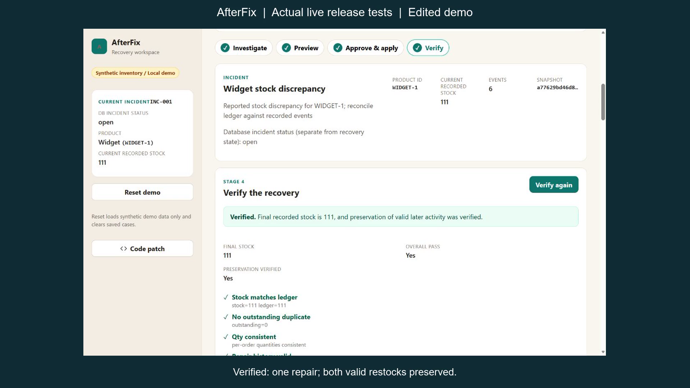

# AfterFix



## Hosted preview —2026-10-31

[Open AfterFix](https://afterfix.sklab.cc). The synthetic dashboard opens directly without a login page. Public access is view-only; choose **Operator access** inside the dashboard for private repair controls. The latest Linux build passed601Python tests, three native frontend checks and the strict production build. Public-read and private-mutation boundaries, cancelled operator verification and role changes were checked. Earlier32Rust tests and hardened hosting evidence are retained. See [direct dashboard evidence](docs/evaluations/direct-dashboard-2026-10-31.json) and [deployment instructions](deploy/README.md).

The interface includes a light/dark switch with a remembered theme preference, a compact recovery workspace and a collapsible Scenario Lab. Mouse/keyboard switching, reload persistence,360/390px layouts and viewer/operator confirmation states were checked in an isolated preview; public HTTPS sign-in and theme switching were checked after the static update. See [UI evidence](docs/evaluations/ui-themes-2026-10-31.json).

The desktop dashboard now places recovery controls beside the evidence inspector, with compact incident context and a concise case-history empty state. Login was excluded from this refinement. A clearly labelled offline transport with the real Rust verifier exercised the populated preview, approval, apply, verification and report layouts; these fixture results are separate from live Meta evidence. See [dashboard checks](docs/evaluations/dashboard-refinement-2026-10-31.json).

Live AI investigation is currently unavailable because the configured Meta account returned a billing error. The hosted instance has no Meta key provisioned; investigation fails closed before provider requests. The earlier real Meta recovery evidence and edited demo below remain historical results. Access keys are provided privately by the operator; never enter a Meta API key in the browser.

## Current release validation —2026-10-30

Scenario Lab is integrated: three explicit synthetic demonstrations, separate load confirmation, safe missing-evidence rejection, and stale approval invalidation. Full strict frontend build and native scenario/API-session/case-state checks passed. Browser360/390/1280 viewport checks and delayed-initial-response/disabled404 checks passed.

An isolated official Python3.14.10 (OpenSSL3.5.9, SQLite3.50.4) and Rust1.98.1 rebuild passed573Python and32Rust tests with unchanged product source. Global runtimes were not upgraded. This is compatibility evidence, not an all-platform or security certification. See [runtime results](docs/evaluations/release-runtime-2026-10-30.json).

A separate real Meta release smoke retained its initial provider failure, rejected a missing-opening draft through validation, and completed stale-snapshot recovery101to111 after a fresh explicit investigation and approval. Both valid restocks20+1 and unrelated stock45 were preserved; old approval apply returned409. Four investigations cost a conservative$0.0357975, including one unknown call charged at its full bound. This does not replace or improve the frozen5/7 benchmark. See [live results](docs/evaluations/release-live-2026-10-30.json) and the [edited live-run demo script](docs/DEMO_RELEASE_SCRIPT.md).

The historical setup and earlier evidence below are retained with their original versions/counts. Current source includes Scenario Lab and deployment packaging. Use private operator credentials for mutation; public access must not expose a known test-fixture operator token.


AfterFix is a local, synthetic inventory-recovery demo. It helps an operator investigate inventory damaged by a duplicate-delivery bug after the code fix, review an evidence-linked repair, approve it explicitly, apply it separately, and verify that valid activity was preserved.

It is not a production recovery product, an arbitrary SQL repair tool, or a universal rollback system. No security certification, production readiness, or perfect reliability is claimed.

## What the demo shows

The canonical incident records stock changing **100 → 80 → 100**:

1. An initial stock of 100 is recorded.
2. A duplicate delivery deducts the same 10-unit order twice, taking stock to 80.
3. A legitimate 20-unit restock takes stock to 100.
4. The code is fixed, but the stored stock remains wrong.
5. AfterFix investigates the evidence, calculates a 10-unit reversal, and previews stock **100 → 110**.
6. A human reviews the evidence, checks the review box, approves, and then applies as a separate action.
7. Verification confirms stock 110, preservation of the restock and unrelated product, and the supporting ledger checks.

Deterministic software calculates quantities and validates invariants. The Meta model performs the bounded, read-only investigation and must cite observed evidence; model text is not treated as fact or as an instruction to write data.

## Current verified status

Latest recorded checks:

- Backend: **403 passed**, with one existing warning.
- Rust: **17 unit tests + 15 CLI tests**, plus **184 independent cases**.
- Frontend: strict TypeScript/Vite build passed, **22 modules in 228 ms**.
- Native Node API-session and case-state checks passed.
- An actual authenticated Chrome recovery using real Spark 1.3 completed **100 → 110** with one actor-bound approval/repair and **10 preservation checks passed**.
- Durable version 1 reports, saved case history, read-only reload, and exact JSON download are implemented.
- Saved case history loads as read-only data; it never restores approval, checkbox, or apply state. Any new mutation requires a fresh, explicit investigation.
- A browser reload forgets operator access and opens the public dashboard. Re-enter the operator key inside the dashboard only when needed.
- Actual stale-state checks passed: an approval/apply `409` invalidates downstream state and refreshes to stock 101 with 5 events. When refresh returns `503`, the old data remains visible with a clear warning. The final independent database check found 0 repairs in that failure path.
- Actual desktop viewport checked: **1280 × 585**, with no horizontal overflow. This was not a mobile check.

The first immutable seven-case live benchmark remains **5/7 passed, 2/7 failed**, using 21 calls and an estimated **$0.0683165**. Cases H02 and H04 returned invalid/incomplete responses and are retained as failures. There has been no v1 rerun. The later 2048 output-cap correction passed offline regressions, but its live effect has not been measured.

Offline fixtures are test evidence only; they are not live model evidence. Actual desktop offline Chrome checks now cover delayed old-report discard, simulated budget/dependency failures, and dialog keyboard/focus behaviour; see [browser session/failure evidence](docs/evaluations/browser-session-failure-2026-10-28.json). In that evidence, a delayed old operator report was released after 7.66 seconds following sign-out/viewer sign-in and was discarded; the new viewer session remained read-only. A simulated pre-provider budget denial and a model-dependency `503` were handled without automatic retry or downstream mutation. Patch/evidence dialogs were checked with Enter, Tab through `BODY -> DIALOG -> Close`, and Escape returning focus to the opener; no underlying page action was focused. This is not an accessibility certification. Subsequent actual Chrome viewport checks at **390 × 844**, **360 × 800**, and **1280 × 800** verified the CSS overflow correction in saved history and preview, fitting dialogs and mobile approval/viewer controls. See [responsive evidence](docs/evaluations/mobile-layout-accepted-f6f91d55.json). These are browser viewport checks, not physical-device or live-provider mobile end-to-end tests.

The backend 403-test result is historical evidence. Another99 focused dependency-audit offline tests passed separately.

Dependency evidence now has two snapshots. The original snapshot returned 12 advisory IDs forming six GHSA/PYSEC alias pairs for the fresh-clone installer pip 25.0.1; the other 102 triples had no indexed matches in that snapshot. After the hash-pinned bootstrap upgrade to pip 26.2.2, a new actual 103-package public OSV query completed with 0 indexed matches and no partial counts, independently checked for mappings, order, hashes, and delta. The original 12-ID/six-issue snapshot remains unchanged. This is not a security certification and does not assess unknown issues, OS/SQLite/toolchain advisories, or pip vendored libraries. See [dependency results](docs/DEPENDENCY_RESULTS.md) and the [verified bootstrap evidence](docs/evaluations/bootstrap-verified-v2/lead-review.json).

## Windows PowerShell setup

The lead validated pinned revision dd660c5 on Windows in separate fresh local clones: Python/Rust installation and tests, native checks and seven offline cases, plus fresh frontend install/build under npm12.0.2. This was split validation, not a single all-in-one run. Earlier failed attempts are retained; see [fresh frontend evidence](docs/evaluations/frontend-repro-accepted-2026-10-28.json). Keep at least 1 GiB disk headroom before dependency installation; a full drive caused a recorded install failure.

From the repository root, create an isolated Python environment. Do not recreate an existing `.venv` automatically; create it only if it does not already exist:

```powershell
py -m venv .venv
```

Before installing the application requirements, use the explicit `.venv` Python (not an activation-dependent `python`) to upgrade the installer from the separate hash-pinned bootstrap file:

```powershell
.\.venv\Scripts\python.exe -I -m pip --isolated --disable-pip-version-check --no-input install --index-url https://pypi.org/simple --keyring-provider disabled --only-binary=:all: --no-deps --no-cache-dir --require-hashes --upgrade -r requirements-bootstrap.txt
.\.venv\Scripts\python.exe -I -m pip --version
```

The lead has now actually validated this exact hash-pinned bootstrap command on the project `.venv`: pip changed from 25.0.1 to 26.2.2, the other 23 PyPI distributions were unchanged, the explicit project pip reported 26.2.2, and `pip check` reported “No broken requirements found.” All six QA steps exited 0. See the [verified bootstrap evidence](docs/evaluations/bootstrap-verified-v2/lead-review.json).

The version output must require pip 26.2.2. Stop on bootstrap failure or version mismatch rather than continuing or installing an unreviewed alternative. The bootstrap hash pins this installer wheel only; the application requirements are existing version pins, not a comprehensive hash lock.

Then install the application requirements as a separate step and check the environment:

```powershell
.\.venv\Scripts\python.exe -I -m pip --isolated --disable-pip-version-check --no-input install --index-url https://pypi.org/simple --keyring-provider disabled --only-binary=:all: --no-cache-dir -r requirements.txt
.\.venv\Scripts\python.exe -I -m pip check
```

The application-requirements install command above was **not rerun** as part of the bootstrap validation. The historical fresh-clone evidence predates the bootstrap change, so it does not by itself validate a complete fresh checkout using the new bootstrap.

Build and test the Rust verifier **before** running the Python suite, because the API integration requires the release binary:

```powershell
cargo build --locked --release --manifest-path rust-verifier/Cargo.toml
cargo test --locked --manifest-path rust-verifier/Cargo.toml
.\.venv\Scripts\python.exe -m pytest -q
```

The lead recorded Windows toolchain versions on 2026-10-28: **Python 3.12.10, Node v24.18.0, npm 12.0.2, rustc/cargo 1.98.0**. Cross-platform testing is pending.

## Run locally

Start the backend on loopback port 18157:

```powershell
.\.venv\Scripts\python.exe -m uvicorn app.main:app --host 127.0.0.1 --port 18157
```

In a second PowerShell window, start the frontend:

```powershell
cd frontend
npm ci --ignore-scripts
npm run dev
```

The development frontend uses port **18173** by default and proxies API requests to the backend. For a production-style frontend build:

```powershell
npm run build
```

Do not use a default `uvicorn` port-8000 quick start with this demo; it conflicts with the configured local proxy expectation of port 18157.

Deterministic tests and offline routes do not require a Meta credential. A live investigation is explicitly paid and gated; it is not part of the deterministic test run.

## Access and live-runtime configuration

Before using protected routes, read [docs/AUTH.md](docs/AUTH.md) and [docs/RUNTIME.md](docs/RUNTIME.md).

- Configure the server-only `MODEL_API_KEY` through a protected process environment. Never put it in command arguments, source, browser storage, logs, or reports.
- Set `AFTERFIX_RUNTIME_DIR` to a trusted absolute path that already contains the existing shared runtime ledger for this project.
- All related processes must share that ledger. Do not create a second ledger for an existing project.
- Use the runtime initializer only for a genuinely new, zero-usage project. For an existing owner/shared ledger, never reset it and never start a new split ledger; follow [docs/RUNTIME.md](docs/RUNTIME.md).
- Application access tokens are separate from the Meta key. Use distinct URL-safe tokens of 32–128 characters for operator and, optionally, viewer. There are no default or public QA credentials.
- For a public synthetic demo, explicitly set `AFTERFIX_PUBLIC_VIEWER=1`. The fixed demo's read-only GET routes open without a key; all anonymous mutations remain denied. The default remains private. The frontend always opens the dashboard, with an optional Operator access dialog.
- Reset is allowed only for the operator and only when `AFTERFIX_ALLOW_RESET=1` is explicitly set.
- The shared guard uses a $100 project cap, $50 reserve, and 24-hour credit-freshness check. Account-wide usage outside this ledger is uncertain, so no overage is assumed or authorized.
- Each investigation is bounded to 6 calls and an estimated $0.25 guard.

No private control path is required in a public checkout.

## Saved reports

After an investigation, the durable version 1 case report can be reloaded read-only and downloaded as exact JSON. Reloading a saved case does not restore approval, checkbox, or apply state and does not start a new investigation or mutation.

## Further documentation

- [Release handoff](docs/RELEASE_HANDOFF.md)
- [Runtime and budget guard](docs/RUNTIME.md)
- [Authentication and roles](docs/AUTH.md)
- [Rust protocol](docs/RUST_PROTOCOL.md)
- [Rust integration](docs/RUST_INTEGRATION.md)
- [Evaluation results](docs/EVALUATION_RESULTS.md)
- [Dependency results](docs/DEPENDENCY_RESULTS.md)
- [Verified bootstrap evidence](docs/evaluations/bootstrap-verified-v2/lead-review.json)
- [Delivery plan](docs/DELIVERY_PLAN.md)
- [Current state](docs/STATE.md)
- [Actual canonical browser recovery evidence](docs/evaluations/browser-rust-recovery-2026-10-28.json)
- [Browser session/failure evidence](docs/evaluations/browser-session-failure-2026-10-28.json)
- [Stale-refresh browser evidence](docs/evaluations/browser-stale-refresh-2026-10-28.json)

## Scope limits

Version 1 covers evidenced duplicate inventory-deduction recovery in a synthetic local demo. It does not support arbitrary SQL, uploaded production databases, unattended apply, automatic approval, or universal rollback. Public hosting, repository publication, video publication, and contest submission require separate owner tasks.
