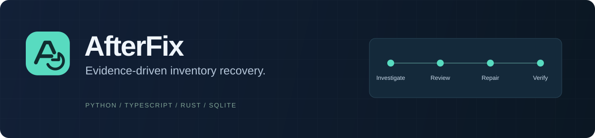
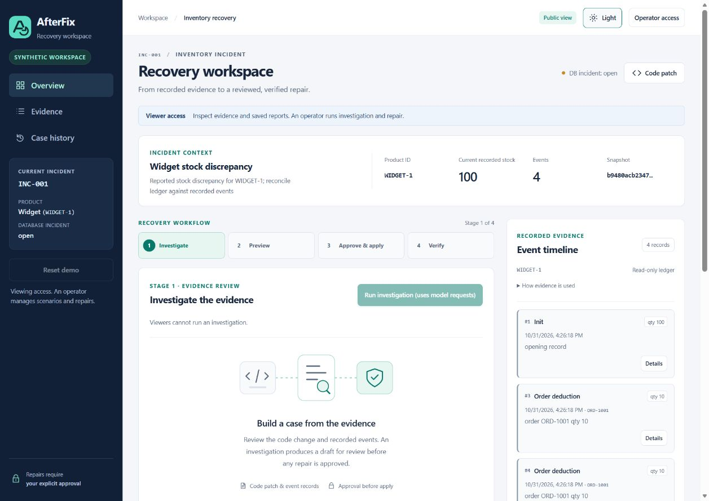
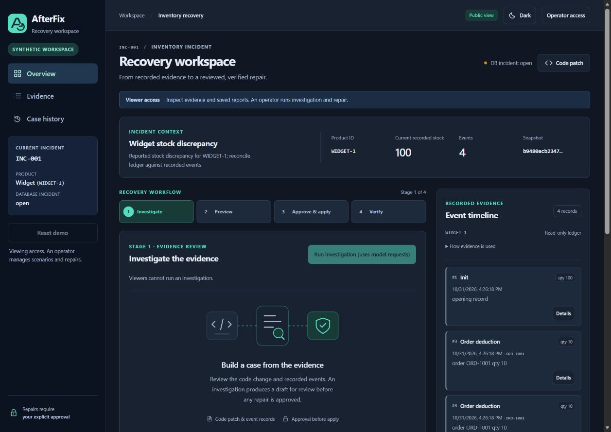

<p align="center">
  
</p>

<p align="center">
  <a href="https://afterfix.sklab.cc">Live preview</a> ·
  <a href="docs/INSTALL_AGENT.md">Install locally</a> ·
  <a href="https://github.com/ShahadatTest/afterfix/releases/tag/v0.1.0-rc1">Recorded demo</a> ·
  <a href="docs/README.md">Documentation</a> ·
  <a href="CONTRIBUTING.md">Contribute</a> ·
  <a href="LICENSE">MIT license</a>
</p>

# AfterFix

**Investigate inventory damage after a code fix, review an evidence-linked repair, and verify what changed.**

Fixing a duplicate-delivery bug does not fix the stock it already deducted twice. AfterFix reads the code change and event evidence, uses Meta AI to investigate, and checks a proposed repair with Python and an independent Rust verifier. A human approves before a separate transactional apply.

> **Current availability:** the shared synthetic dashboard is online. Live Meta investigation is unavailable until provider billing is cleared and its server-side key/budget are provisioned. Installation and scanning work without a model key. Historical live runs and new offline fixture results are labelled separately below.



<details>
<summary>Dark theme and connected-agent screenshots</summary>



See the [screenshot gallery](docs/README.md#screenshots) for installation controls and the explicitly labelled offline connected-agent fixture.

</details>

## What it does

- **Investigate:** bounded read-only Meta tools inspect the code fix and selected event records. Claims must cite observed evidence.
- **Preview:** Python calculates the repair; Rust independently checks arithmetic and references against the snapshot.
- **Approve and apply:** explicit human approval and a separate apply action preserve actor, snapshot, transaction and retry guards.
- **Verify and export:** preservation checks, audit facts and versioned case reports explain the resulting state.
- **Connect locally:** an installable SQLite agent backs up a compatible file, scans for supported candidates and opens an incident for review.

The canonical example is **100 → 80 → 100**: a 10-unit order is deducted twice, then a valid 20-unit restock occurs. The supported repair restores only the extra deduction, producing **110** while preserving the restock and unrelated product. Quantities come from the evidence; 110 is not hardcoded into the repair engine.

## Install the local agent

Requirements: **Git, Python 3.12+ and running Docker with Linux containers**. Node, Rust and the application dependencies build inside Docker.

```sh
git clone https://github.com/ShahadatTest/afterfix.git
cd afterfix
python -m app.agent install
```

The terminal asks for your inventory SQLite file, selected product, code-fix patch and a new private directory. Before extending the schema, it requires explicit consent and saves an integrity-checked backup. The agent opens on loopback; use the private application key in **Operator access** to unlock inventory data.

Startup/manual scanning changes incident metadata, not stock. Investigation is an explicit model request; approval and apply remain separate. The first connector supports **one selected product and a fixed inventory-ledger schema**. Read the [schema contract, installation changes and Meta configuration](docs/INSTALL_AGENT.md) before connecting a file. The actual Docker installation was validated on Linux; Windows Docker end-to-end compatibility is not claimed.

## Validation you can inspect

| Evidence | Recorded result | Scope |
| --- | --- | --- |
| [Current local-agent acceptance](docs/evaluations/installable-agent-2026-10-31.json) | **623 Linux Python tests passed**; 22 focused Windows connector tests passed | 2026-10-31 snapshot, one existing TestClient warning |
| [Independent verifier](docs/RUST_INTEGRATION.md) | 32 Rust tests and 184 independent cases | Earlier accepted verifier; real Rust also exercised in connected-agent tests |
| [Connected install/recovery](docs/evaluations/installable-agent-2026-10-31.json) | Actual Docker install; stock 282→300; restock 43 and unrelated stock 64 preserved | **Offline tool response**, real SQLite/Rust/approval/apply/report; zero provider requests |
| [Historical live release smoke](docs/evaluations/release-live-2026-10-30.json) | Fresh recovery 101→111; stale approval rejected | Real Meta requests; retained initial provider failure and missing-evidence rejection |
| [Frozen live benchmark](docs/EVALUATION_RESULTS.md) | **5/7 passed, 2/7 failed** | Original immutable seven-case evaluation; not rerun or replaced |
| [UI and hosting](docs/evaluations/branding-motion-2026-10-31.json) | Light/dark, mobile layout, reduced motion and hardened HTTPS preview checked | Browser viewport checks, not device/accessibility/security certification |

These are dated acceptance snapshots, not a claim that GitHub CI ran on every commit. The repository's [Linux build workflow](.github/workflows/linux-release.yml) is manually dispatched.

## Watch the recorded demo

[**Open the v0.1.0-rc1 demo and assets →**](https://github.com/ShahadatTest/afterfix/releases/tag/v0.1.0-rc1)

The 179.98-second video uses screenshots from actual historical live tests with generic text-to-speech narration. It is an edited demonstration, not a continuous recording. Its source archive is pinned to the older release checkpoint; use the current branch and [installation guide](docs/INSTALL_AGENT.md) for the local agent and current interface.

## Architecture

**TypeScript/React** presents evidence and human controls. **Python/FastAPI + SQLite** owns the model loop, state, transactions and reports. **Rust** performs independent bounded verification without database or network access.

The model cannot run SQL, shell commands, approve a proposal or apply a repair. Unsupported evidence, stale state or verifier disagreement blocks the write path. Read the [architecture and component map](docs/ARCHITECTURE.md).

## Project scope

This is an experimental inventory-recovery project with a documented SQLite connector and synthetic/isolated-fixture validation. Arbitrary database repair, PostgreSQL, unattended apply, tenant isolation, production readiness and universal rollback are outside the current release.

## License

AfterFix project source is licensed under the [MIT License](LICENSE), copyright 2026 Shahadat Islam Koyel. Dependencies retain their respective licenses. Meta models/API and other external services are not licensed by this repository.

[Development](docs/DEVELOPMENT.md) · [Security](SECURITY.md) · [Model provenance](docs/MODEL_PROVENANCE.md) · [Full documentation](docs/README.md) · [Current state](docs/STATE.md)
