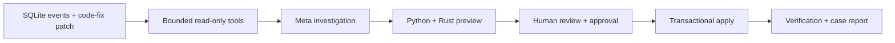

# Architecture

AfterFix investigates persisted inventory damage after an application bug has been fixed. The first local connector supports a documented SQLite inventory ledger and one selected product per installation.

The startup/manual scanner identifies supported candidates and updates incident metadata. It does not invoke a model, approve a proposal or change inventory values. A candidate still needs investigation and a validated preview.

## Responsibilities

| Component | Responsibility | Source |
| --- | --- | --- |
| Local agent | Validate/connect inventory, back up before schema extension, start/stop a local container | [agent.py](../app/agent.py) |
| API | Authentication, roles, request limits and explicit workflow endpoints | [main.py](../app/main.py), [auth.py](../app/auth.py) |
| Investigator | Inspect a patch and requested events; validate structured model claims/citations | [investigator.py](../app/investigator.py) |
| Meta client | Official API transport and usage accounting | [meta_client.py](../app/meta_client.py) |
| Budget guard | Shared reservations, cap, reserve, freshness and one active request | [runtime_budget.py](../app/runtime_budget.py) |
| Recovery engine | Quantities, disposable simulation, snapshot checks, approval, transaction and idempotency | [recovery.py](../app/recovery.py) |
| Rust verifier | Independent bounded arithmetic/reference checks; no network or database access | [rust-verifier](../rust-verifier), [adapter](../app/rust_verifier.py) |
| Storage/reports | SQLite persistence, fingerprints and versioned reports | [store.py](../app/store.py), [case_report.py](../app/case_report.py) |
| Interface | Evidence review, explicit repair controls, light/dark themes and report downloads | [frontend/src](../frontend/src) |

## Write boundary

The model has only `get_patch` and `read_events`. It receives no SQL, shell, reset, approval or apply tool. Python computes the proposed change and Rust must agree before the repair can proceed. Apply requires the approved actor/proposal/snapshot, checks current state inside its transaction and records an idempotency key. Valid restocks and unrelated products are checked for preservation.

Agent installation is a separate explicit schema operation: it first creates a verified backup, then adds AfterFix metadata tables and repair columns. Subsequent scans update incident metadata only. See the [connector contract and consent requirements](INSTALL_AGENT.md#supported-sqlite-contract).

## Two operating modes

| Mode | Data | Access | Current availability |
| --- | --- | --- | --- |
| Hosted preview | Shared synthetic inventory | Narrow public reads; private operator mutations | Dashboard online; live Meta runtime not provisioned |
| Local agent | Selected compatible SQLite file | Loopback UI/API; private operator unlock; public reads/reset/Lab disabled | Installation and connected recovery tested with isolated fixtures |

The local agent serves bundled UI and `/api` from one container. A server-side Meta key and verified shared ledger are optional for installation/scanning and required for live investigation. Only explicitly requested patch/event excerpts enter the model context; keys remain server-side. See [runtime configuration](RUNTIME.md).

This is a single-instance experimental design. It does not provide arbitrary schema mapping, tenant isolation, unattended repair, universal rollback or production validation.
