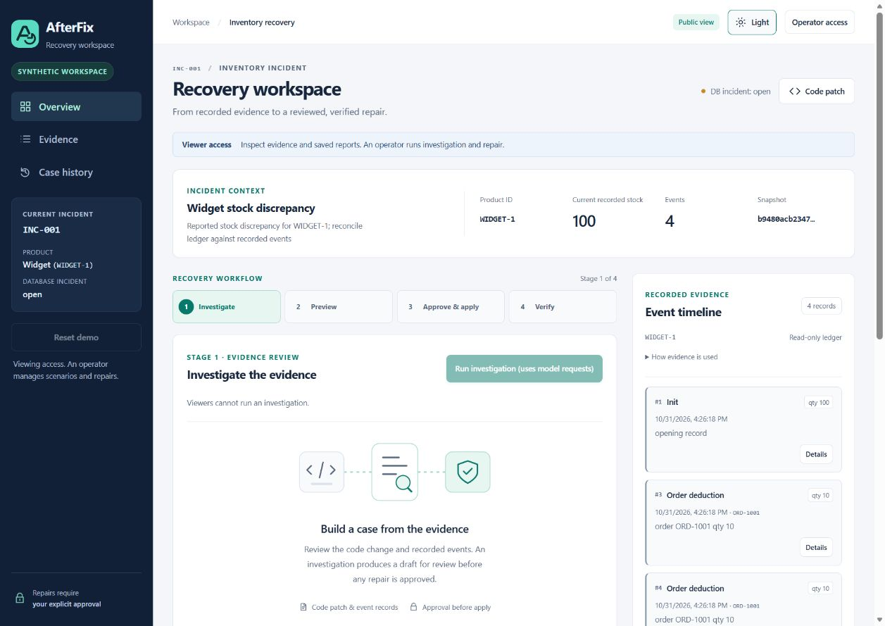
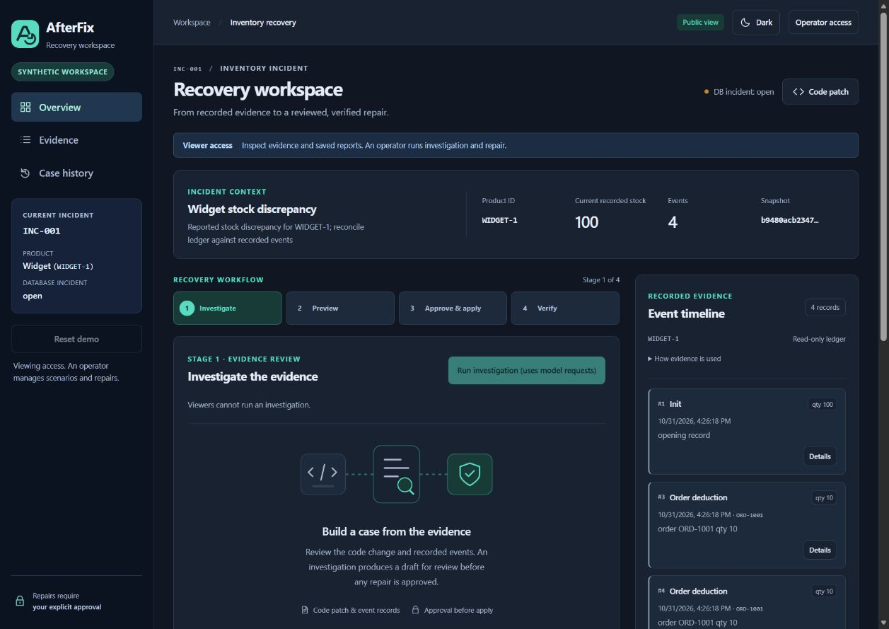
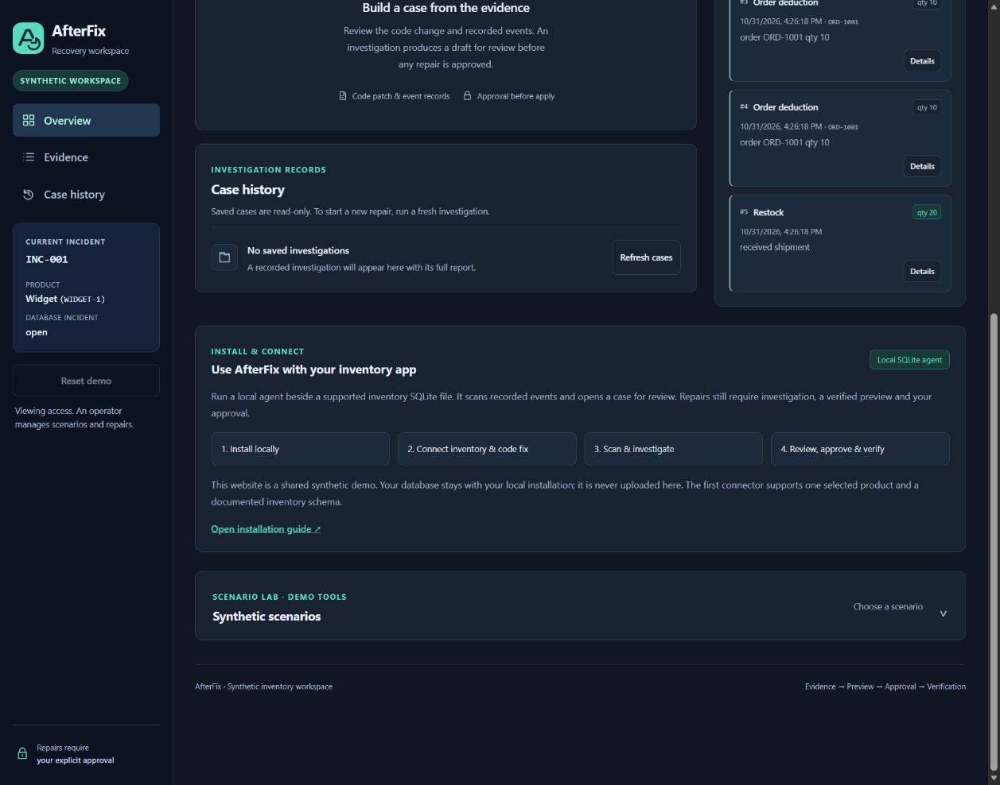
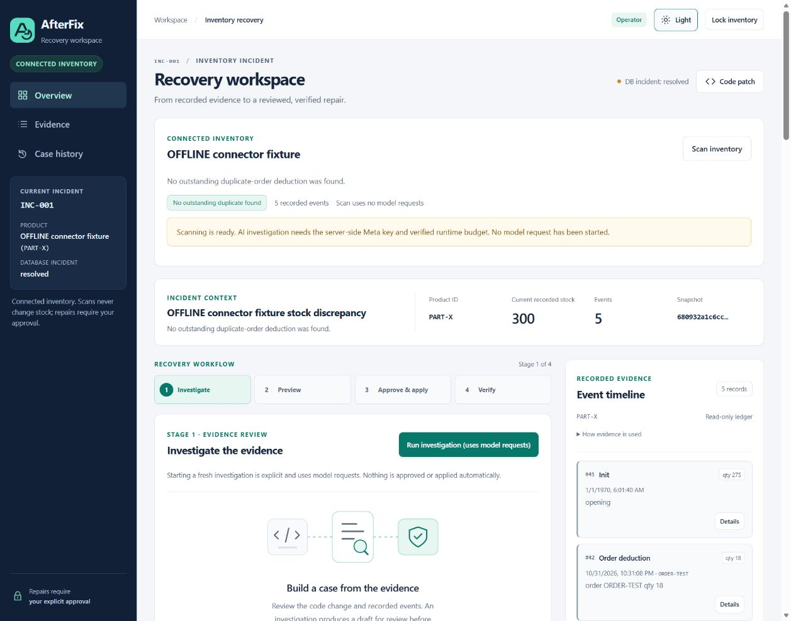

# AfterFix documentation

Start with the [project overview](../README.md), then choose the path that matches what you need.

| I want to… | Read |
| --- | --- |
| Check the project license | [MIT License](../LICENSE) |
| Explore the shared synthetic dashboard | [Live preview](https://afterfix.sklab.cc) |
| Install beside a compatible inventory file | [Local SQLite agent](INSTALL_AGENT.md) |
| Understand the supported schema and installation changes | [Connector contract](INSTALL_AGENT.md#supported-sqlite-contract) |
| Develop the application locally | [Development setup](DEVELOPMENT.md) |
| Understand the architecture and write boundaries | [Architecture](ARCHITECTURE.md) |
| Configure application access | [Authentication and roles](AUTH.md) |
| Configure the Meta key and shared cost guard | [Runtime configuration](RUNTIME.md) |
| Deploy a reviewed server build | [Deployment guide](../deploy/README.md) |
| Understand saved cases and downloads | [Case reports](CASE_REPORTS.md) |
| Explore the synthetic scenarios | [Scenario Lab](SCENARIO_LAB.md) |
| Inspect Rust verification | [Integration](RUST_INTEGRATION.md) · [Protocol](RUST_PROTOCOL.md) |
| Review the latest connected-agent acceptance | [623-test/install/recovery snapshot](evaluations/installable-agent-2026-10-31.json) |
| Review live-model results and failures | [Evaluation results](EVALUATION_RESULTS.md) · [Frozen protocol](EVALUATION_PROTOCOL.md) |
| Inspect model/code provenance | [Model provenance](MODEL_PROVENANCE.md) |
| Contribute or report a bug | [Contributing](../CONTRIBUTING.md) · [Security notes](../SECURITY.md) |

## Screenshots

These are captures of the actual application, not design mockups.

### Public dashboard: light

### Public dashboard: dark

### Install and connect

### Connected-agent validation fixture

This isolated source file was repaired from 282 to 300 using an explicitly injected **offline tool response** and the real SQLite/Rust/approval pipeline. The visible warning correctly states that no live Meta runtime is configured. This is not live AI evidence.

## Dated records

[Current state](STATE.md) records accepted checkpoints and outstanding work. The [historical README](README_HISTORY_2026-10-31.md) preserves earlier validation/setup details; its dated counts and availability statements are not the latest status.
